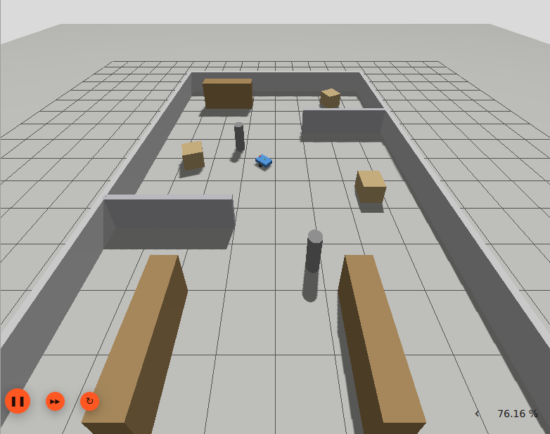

# Proyecto final de Robótica: navegación autónoma

Brayan Mateo Bravo Losada - Ingeniería Electrónica, Escuela Colombiana de Ingeniería Julio Garavito.

Robot diferencial en una bodega simulada de 12 × 8 m. ROS 2 Kilted, Gazebo Sim 9 (Ionic), Ubuntu 24.04 / WSL2.

## Código, imágenes y video

| Material | Acceso |
|---|---|
| Paquete ROS 2, mapas y configuración | [proyecto_final_ws/src/dif_bot](proyecto_final_ws/src/dif_bot) |
| Compilación y comandos por práctica | [Instrucciones](proyecto_final_ws/README.md) |
| Video completo: Gazebo, RViz y terminal | [Ver / descargar MP4](video/Video_Proyecto_Final_Robotica.mp4) |
| Videos por práctica y misión | [P1](video/practicas/p1.mp4), [P2](video/practicas/p2.mp4), [P3](video/practicas/p3.mp4), [P4](video/practicas/p4.mp4), [P5](video/practicas/p5.mp4), [Misión](video/practicas/final.mp4) |
| Índice de experimentos | [Evidencias](evidencias/LEEME.md) |
| Capturas y gráficas usadas en el informe | [Figuras](evidencias/figuras) |
| Scripts auxiliares de pruebas | [herramientas](herramientas) |



## Ejecución

```bash
git clone https://github.com/Mate02010/rospart3.git
cd rospart3/laboratorios/proyecto_final/proyecto_final_ws
source /opt/ros/kilted/setup.bash
colcon build --symlink-install
source install/setup.bash
ros2 launch dif_bot mision.launch.py
```

En otra terminal, cargar ambos `setup.bash` y llamar:

```bash
ros2 service call /iniciar_mision std_srvs/srv/Trigger
ros2 topic echo /estado_mision
# Para cancelar:
ros2 service call /cancelar_mision std_srvs/srv/Trigger
```

Esperar el estado `LISTA` antes de iniciar. Dependencias y lanzadores P1-P5: [README del workspace](proyecto_final_ws/README.md).
La compilación se realiza dentro de este workspace para seleccionar únicamente el paquete `dif_bot`.

## Resultados registrados

| Etapa | Resultado | Registro |
|---|---|---|
| P1: DiffDrive / ros2_control | Latencia al 50 %: 0,20 / 0,28 s; jitter: 0 / 2,75 ms | [P1](evidencias/p1/RESPUESTAS_P1.md) |
| P2: EKF | Error final: ruedas 5,8 cm; EKF con IMU 1,2 cm; sin IMU 20,1 cm | [P2](evidencias/p2/RESPUESTAS_P2.md) |
| P3: SLAM | Resolución 5 cm; error medio 2,61-2,95 cm según velocidad | [P3](evidencias/p3/RESPUESTAS_P3.md) |
| P4: AMCL | Pose incorrecta moderada: converge en 8,21 s; muy lejana: no converge | [P4](evidencias/p4/RESPUESTAS_P4.md) |
| P5: Nav2 | 3/3 sin obstáculo, 3/3 con caja en el camino, 2/3 con meta bloqueada | [P5](evidencias/p5/RESPUESTAS_P5.md) |
| Misión final | 6/6 waypoints, 32,643 m, 147,78 s simulados / 205,48 s reales | [Misión](evidencias/final) |

Son resultados de simulación de las corridas archivadas, sin validación física ni estudio estadístico.
El video es una demostración adicional y sus tiempos no corresponden a las tablas.
La pose `/ground_truth/odom` se usa para evaluar y guiar recorridos de prueba P3/P4;
SLAM, AMCL y Nav2 no la usan para estimar ni navegar.
La misión solo la usa para registrar métricas.

Los CSV, JSON y árboles TF conservan los registros originales. Las rutas absolutas que aparecen
en ellos identifican el entorno de medición; para ejecutar se usan los archivos relativos del paquete.
Los scripts de `herramientas/` y de grabación conservan rutas del PC donde se hicieron las pruebas;
son auxiliares y deben adaptarse si se usan en otra máquina. Los lanzadores del paquete usan rutas ROS.

## Video

El MP4 incluye P1-P5 y la misión, con tarjetas de resultados y tramos acelerados señalados.
No tiene narración. Está almacenado como archivo real en este repositorio.
Los seis clips separados conservan la etiqueta y la aceleración del montaje completo.

## Integridad

[MANIFIESTO_SHA256.txt](MANIFIESTO_SHA256.txt) permite comprobar los archivos publicados.
